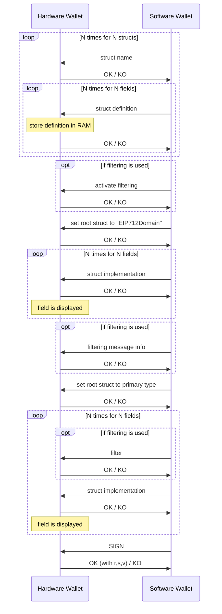

# EIP-712

## Specifications

[Reference](https://github.com/ethereum/EIPs/blob/master/EIPS/eip-712.md)

## Example message

```json
{
    "domain": {
        "chainId": 5,
        "name": "Ether Mail",
        "verifyingContract": "0xCcCCccccCCCCcCCCCCCcCcCccCcCCCcCcccccccC",
        "version": "1"
    },
    "message": {
        "contents": "Hello, Bob!",
        "from": {
            "name": "Cow",
            "wallets": [
                "0xCD2a3d9F938E13CD947Ec05AbC7FE734Df8DD826",
                "0xDeaDbeefdEAdbeefdEadbEEFdeadbeEFdEaDbeeF"
            ]
        },
        "to": {
            "name": "Bob",
            "wallets": [
                "0xbBbBBBBbbBBBbbbBbbBbbbbBBbBbbbbBbBbbBBbB",
                "0xB0BdaBea57B0BDABeA57b0bdABEA57b0BDabEa57",
                "0xB0B0b0b0b0b0B000000000000000000000000000"
            ]
        }
    },
    "primaryType": "Mail",
    "types": {
        "EIP712Domain": [
            { "name": "name", "type": "string" },
            { "name": "version", "type": "string" },
            { "name": "chainId", "type": "uint256" },
            { "name": "verifyingContract", "type": "address" }
        ],
        "Mail": [
            { "name": "from", "type": "Person" },
            { "name": "to", "type": "Person" },
            { "name": "contents", "type": "string" }
        ],
        "Person": [
            { "name": "name", "type": "string" },
            { "name": "wallets", "type": "address[]" }
        ]
    }
}
```

## Implementation



## Traversal

The traversal of the typed data with EIP-712 must follow the same order as the definition of the types. In the second
stage of the flow when receiving the implementation of the domain & message, there is no indication in
[the APDU](apdu.md#eip712-send-struct-implementation) of which field the data is for since the app has knowledge of
all the types it knows the exact order to follow so it keeps track of which field comes next and does its error-handling
accordingly.

## Filtering

Filtering is used for a better clear-signing experience with EIP-712.
It started as a simple way to define which fields to show (with the ability to give them an easier to understand name)
with all the other ones hidden to prevent the user from having too many unrelevant fields to review, and it has now
evolved into something more complex which can apply formatting to the filtered fields.

It has to be defined with the ERC-7730 format. Refer to [clear signing overview](https://developers.ledger.com/docs/clear-signing/overview).

It uses this optional APDU in the flow : [EIP712_FILTERING](apdu.md#eip712-filtering).

## Streaming

The data is streamed to the device, and as there is a lot to store in RAM : all the struct definitions throughout the
entire flow, it was decided to use streaming, so the device starts the message review before having received everything.

This is very efficient with RAM, but this also means the code is more complex to handle this, testing also is because
it makes the navigation difficult with Ragger, and the error-handling is happening as the user is already reviewing the
message which is far from ideal.

## V2

### Sending a message

EIP-712 V2 clear-signing structures. Delivered via the `EIP712 SEND STRUCT DEFINITION`,
`EIP712 SEND STRUCT IMPLEMENTATION` and `EIP712 SIGN` APDUs with `P2 = 0x02`, and, for the
structures that describe how to review the message, `TRANSACTION INFO` and `TRANSACTION FIELD
DESCRIPTION` with `P2 = 0x02` (see
[apdu.md](apdu.md)), distinct from and never mixed with V1's incremental streaming protocol within
the same signing session: a V2 command is refused while a V1 session is in progress. Every payload
below uses the same chunked-TLV transport as `TRANSACTION_INFO`/`FIELD`: each payload is one TLV
blob, chunked uniformly regardless of payload type. The `VERSION` of every structure below is currently `0x01`; any other value is rejected.

Once `EIP712_SCHEMA` is received in full and parsed successfully, it is locked: any further
Schema APDU in the same session is rejected. Unlike V1, which uses a separate "activate"/lock
command, this needs none: one-shot delivery makes completion of the call itself the lock.

### Implementation limits

The structures below describe the wire format, which is deliberately more permissive than any
single device needs to be. An implementation may reject a well-formed payload that exceeds its
own capacity; the following limits apply to this application:

| Limit | Value | Applies to |
|-------|-------|------------|
| Array dimensions per field | 8 | `ARRAY_DIM` entries on one `EIP712_FIELD` |
| Value tree depth | 16 | combined struct nesting and array dimensions in `EIP712_VALUES` |
| Array dimension size | 255 | `ARRAY_DIM` payload value, though the wire type is `uint32` |
| Struct name length | 64 | `NAME` of an `EIP712_STRUCT`, `STRUCT_NAME` of an `EIP712_FIELD` and `PRIMARY_TYPE` |
| Derivation path length | 10 | `DERIVATION_PATH` entries |
| Payload size | available memory | each payload is fully buffered before parsing |
| Elements of an `EIP712_PATH` | 17 | `EIP712_STRUCT_FIELD`, `EIP712_ARRAY_SLICE` and `EIP712_LEAF_SLICE` entries of one path: the deepest leaf of the value tree, plus the slice of that leaf |
| Values one descriptor selects | 16 | values an `EIP712_PATH` leads to, a descriptor selecting more is refused. Same limit as a `DATA_PATH` |
| Nesting of `PARAM_GROUP` | 8 | same as for a transaction |
| Rows of a review | 255 | what the screen library can address: a message that needs more is refused |

Nesting depth is shared between struct nesting and array dimensions, so a field declaring more
array dimensions than the remaining depth budget can never be populated with values.

### Leaf encoding

A value has one encoding only. A leaf is refused unless it is the encoding of a value of the type the
schema gives to its field (`N` is the `TYPE_SIZE` of the field, in bytes):

| Type              | Leaf                                                                                       |
|-------------------|--------------------------------------------------------------------------------------------|
| `uintN`           | big-endian, 1 to `N` bytes, without a leading `0x00` byte unless it is zero itself: `0x00` |
| `intN`            | non-negative: as a `uintN`. Negative: exactly `N` bytes, two's complement                  |
| `bytesN`          | exactly `N` bytes                                                                          |
| `address`         | exactly 20 bytes                                                                           |
| `bool`            | one byte, `0x00` or `0x01`                                                                 |
| `string`, `bytes` | any bytes, including none                                                                  |

For an `intN`, the sign comes from the length: a leaf shorter than `N` bytes is non-negative (`0xFF`
is 255 for an `int16`), and a leaf of `N` bytes is negative when its top bit is set (`-1` is `0xFFFF`
for an `int16`). A non-negative value never has more bytes than it needs, so it is never `N` bytes
long with its top bit set. An empty leaf is only valid for `string` and `bytes`.

Because there is one encoding per value, a byte-for-byte comparison of two leaves (a `MAP_ENTRY`
key, the list of an `IF_NOT_IN` or `MUST_BE` condition) compares values, and the device never signs a
value its type cannot hold (a `uint8` of `0x0100`).

This applies to `EIP712_VALUES` only: a V1 EIP-712 flow still takes the values as it always did.

### EIP712_MESSAGE_INFO

Merged into [TRANSACTION_INFO / EIP712_MESSAGE_INFO](tlv_structs.md#transaction_info--eip712_message_info)
above (`Context` column: `EIP-712 only`/`both`) rather than duplicated as a separate structure,
since almost every tag is identical between SignTx and EIP-712 — only the tags that identify
what is signed differ: `CHAIN_ID`, `CONTRACT_ADDR` and `SELECTOR` for SignTx, `DOMAIN_SEPARATOR` and
`PRIMARY_TYPE_HASH` for EIP-712.

It is delivered through `TRANSACTION INFO` with `P2 = 02` (see [apdu.md](apdu.md)), as one TLV
call, once `EIP712_VALUES` is complete and before the review starts, and at most once per message.
It is refused while a V1 session is in progress.

`VERSION`, `DOMAIN_SEPARATOR`, `PRIMARY_TYPE_HASH`, `FIELDS_HASH`, `OPERATION_TYPE` and `SIGNATURE`
are required, and `CHAIN_ID`, `CONTRACT_ADDR` and `SELECTOR` are refused. The creator, contract
name and deploy date tags are optional as in `TRANSACTION_INFO`. The signature is verified with the
same key usage as `TRANSACTION_INFO` (`CERTIFICATE_PUBLIC_KEY_USAGE_CALLDATA`).

The struct is then bound to the message it comes with, and refused (`SWO_INCORRECT_DATA`) if:

- `DOMAIN_SEPARATOR` is not `hashStruct(domain)` of the message's domain;
- `PRIMARY_TYPE_HASH` is not `keccak256(encodeType(primaryType))` of the message's type.

`PRIMARY_TYPE_HASH` does not cover `EIP712Domain`, which `DOMAIN_SEPARATOR`, `hashStruct(domain)`,
covers: every field of the domain, with its type, its `chainId` and `verifyingContract` included.
The message is on the chain of its domain, and is for its contract, when it has them.

`FIELDS_HASH` semantics for EIP-712: identical mechanism to SignTx — a running hash accumulated
over the **raw TLV bytes of each EIP712_FIELD descriptor as received** (order = transmission
order), checked once against the signed value. The commitment is at the descriptor-declaration
level (including any wildcard/slice), not at resolved-match level, so a descriptor whose path
matches zero elements at runtime (e.g. an empty array) is still correctly accounted for. This is
why EIP-712 V2 needs no equivalent to V1's per-filter "discarded path" signed marker: V1 signed
each filter individually and needed to separately prove non-existence; V2's single accumulated
hash over all descriptors' raw bytes sidesteps the problem structurally.

> [!NOTE]
> A `FIELDS_HASH` other than the hash of no descriptors announces
> [EIP712_FIELD_DESCRIPTOR](tlv_structs.md#eip712_field_descriptor)s, which are then received with `TRANSACTION
> FIELD DESCRIPTION` (`P2 = 02`) before `EIP712 SIGN`, and checked against it there. The message is
> reviewed through them. With the hash of no descriptors, the message is reviewed raw, behind the
> blind signing warning.

### Receiving descriptors

Descriptors are sent with `TRANSACTION FIELD DESCRIPTION` and `P2 = 02`, one per command (chunked
as any TLV payload), in the order the `FIELDS_HASH` was computed on. They are accepted once the
`EIP712_MESSAGE_INFO` of the message announced some, and until `EIP712 SIGN`. For each one the app:

1. parses it, and checks it is well-formed, as for a transaction;
2. adds its raw bytes to the running hash, and rolls that back if it cannot be formatted;
3. formats what it selects, and keeps the result for the review.

A descriptor is therefore refused when it cannot be applied to the message, rather than when the
review is built: for example when its path leads nowhere. Any refusal ends the flow, as for every
other command.

A descriptor chooses what is shown: a value of the message that no descriptor selects is not part of
the review. The `FIELDS_HASH` attests that choice, as it does for a transaction.

For a value, `TYPE_FAMILY` and `TYPE_SIZE` are the ones of the descriptor, and are not checked
against the type the schema gives to the leaf: this is what lets a `bytes` leaf be read as packed
numbers of other types, with an [EIP712_LEAF_SLICE](tlv_structs.md#eip712_leaf_slice). What a formatter needs from
the length of a value it checks itself, as for a transaction.

All the `PARAM_*` types are supported, as for a transaction. A `PARAM_CALLDATA` names a call: the
calldata is read in the message, and the call is then described as a transaction, with a
`TRANSACTION INFO` and `TRANSACTION FIELD DESCRIPTION` of its own (`P2 = 00`), either right after the descriptor that names
it or after the descriptors of the message, as in [gcs.md](gcs.md). Its `ENUM_VALUE` and `MAP_ENTRY`
are keyed by its selector. A `PARAM_ENUM` or a `MAP_REF` of a message looks its `ENUM_VALUE` or
`MAP_ENTRY` up with the domain separator and the hash of the primary type of the message, whatever
chain or contract it has. `BUNDLED` groups are not supported, as for a transaction.

### Reviewing a described message

At `EIP712 SIGN`, with descriptors announced:

- the descriptors received have to be exactly the ones the `FIELDS_HASH` attests, the same bytes in
  the same order, and every call they named has to be described and to have received all of its
  descriptors. Otherwise the command is refused, without showing anything;
- the message is shown through its descriptors, as a transaction is: who the message is for
  (the contract information, as for a transaction), the account that signs unless a descriptor shows
  it (`CONTAINER_PATH` `FROM`), the descriptors in the order they were sent, and the network when the
  chain of the message is not the one of the app. The calls the message names are shown in the order
  they were described, one after the other, numbered when there is more than one. There is no fee,
  nonce or hash to show for a message;
- it is not blind signing: there is no warning, and the blind signing setting does not matter.
  Descriptors are what make the review readable, and `FIELDS_HASH` is what makes them authentic.
