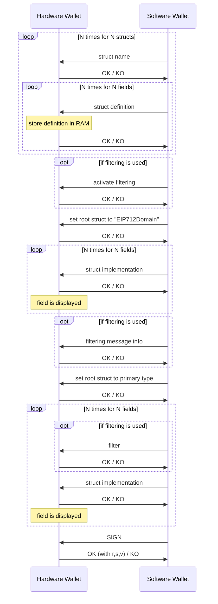

# EIP-712

## Specifications

[Reference](https://github.com/ethereum/EIPs/blob/master/EIPS/eip-712.md)

## Example message

```json
{
    "domain": {
        "chainId": 5,
        "name": "Ether Mail",
        "verifyingContract": "0xCcCCccccCCCCcCCCCCCcCcCccCcCCCcCcccccccC",
        "version": "1"
    },
    "message": {
        "contents": "Hello, Bob!",
        "from": {
            "name": "Cow",
            "wallets": [
                "0xCD2a3d9F938E13CD947Ec05AbC7FE734Df8DD826",
                "0xDeaDbeefdEAdbeefdEadbEEFdeadbeEFdEaDbeeF"
            ]
        },
        "to": {
            "name": "Bob",
            "wallets": [
                "0xbBbBBBBbbBBBbbbBbbBbbbbBBbBbbbbBbBbbBBbB",
                "0xB0BdaBea57B0BDABeA57b0bdABEA57b0BDabEa57",
                "0xB0B0b0b0b0b0B000000000000000000000000000"
            ]
        }
    },
    "primaryType": "Mail",
    "types": {
        "EIP712Domain": [
            { "name": "name", "type": "string" },
            { "name": "version", "type": "string" },
            { "name": "chainId", "type": "uint256" },
            { "name": "verifyingContract", "type": "address" }
        ],
        "Mail": [
            { "name": "from", "type": "Person" },
            { "name": "to", "type": "Person" },
            { "name": "contents", "type": "string" }
        ],
        "Person": [
            { "name": "name", "type": "string" },
            { "name": "wallets", "type": "address[]" }
        ]
    }
}
```

## Implementation



## Traversal

The traversal of the typed data with EIP-712 must follow the same order as the definition of the types. In the second
stage of the flow when receiving the implementation of the domain & message, there is no indication in
[the APDU](apdu.md#eip712-send-struct-implementation) of which field the data is for since the app has knowledge of
all the types it knows the exact order to follow so it keeps track of which field comes next and does its error-handling
accordingly.

## Filtering

Filtering is used for a better clear-signing experience with EIP-712.
It started as a simple way to define which fields to show (with the ability to give them an easier to understand name)
with all the other ones hidden to prevent the user from having too many unrelevant fields to review, and it has now
evolved into something more complex which can apply formatting to the filtered fields.

It has to be defined with the ERC-7730 format. Refer to [clear signing overview](https://developers.ledger.com/docs/clear-signing/overview).

It uses this optional APDU in the flow : [EIP712_FILTERING](apdu.md#eip712-filtering).

## Streaming

The data is streamed to the device, and as there is a lot to store in RAM : all the struct definitions throughout the
entire flow, it was decided to use streaming, so the device starts the message review before having received everything.

This is very efficient with RAM, but this also means the code is more complex to handle this, testing also is because
it makes the navigation difficult with Ragger, and the error-handling is happening as the user is already reviewing the
message which is far from ideal.

## V2

The sections above describe V1. V2 sends the whole message at once: the schema and the values are two TLV payloads, a
signed message info and field descriptors are optional, and `EIP712 SIGN` starts the review. The device receives and
checks the message in full before it shows anything, so a refusal comes before the review. A described message
uses the same [ERC-7730](https://eips.ethereum.org/EIPS/eip-7730) description and the same formatters as a
transaction.

The structures are described in [tlv_structs.md](tlv_structs.md#eip712_schema), the commands in [apdu.md](apdu.md) and the
flow in [gcs.md](gcs.md#the-case-of-typed-messages-eip-712-v2).

### Sending a message

An EIP-712 message is sent to the device whole, as TLV structures. The device computes the type
hashes and the value hashes itself, and reviews the message before it signs. The structures are
sent in this order:

1. [EIP712_SCHEMA](tlv_structs.md#eip712_schema), with `EIP712 SEND STRUCT DEFINITION` and `P2 = 02`.
2. [EIP712_VALUES](tlv_structs.md#eip712_values), with `EIP712 SEND STRUCT IMPLEMENTATION` and `P2 = 02`.
3. A [PROXY_INFO](tlv_structs.md#proxy_info), with `PROVIDE PROXY INFO`, when the
   `verifyingContract` of the domain is a proxy and the message info is the one of its
   implementation. It is optional.
4. [EIP712_MESSAGE_INFO](#eip712_message_info), with `PROVIDE OPERATION INFO` and `P2 = 02`. It is
   optional.
5. When the message info announces field descriptors, one
   [EIP712_FIELD_DESCRIPTOR](tlv_structs.md#eip712_field_descriptor) per command, with
   `PROVIDE OPERATION FIELD DESCRIPTION` and `P2 = 02`.
6. `EIP712 SIGN` with `P2 = 02`, which starts the review.

See [apdu.md](apdu.md) for the commands. Each structure is one TLV payload, sent in chunks like an
`OPERATION_INFO` and a `FIELD`. V1 and V2 never mix, see [EIP-712 versions](apdu.md#eip-712-versions).
Every EIP712_* structure that has a `VERSION` tag takes `0x01`, and the device refuses any
other value. It also refuses a structure that holds a tag the structure does not define, that holds
a tag twice when the tag is not repeated, or that lacks a required tag, one whose `Optional` cell is
empty.

The device locks the schema once it has received and accepted it. A second schema in the same
session is refused.

### Implementation limits

The wire format allows more than the device can hold. The device refuses a well-formed payload that
goes past one of these limits:

| Limit                         | Value            | Applies to                                                                                                                                 |
|-------------------------------|------------------|--------------------------------------------------------------------------------------------------------------------------------------------|
| Array dimensions per field    | 8                | `ARRAY_DIM` entries of one `EIP712_FIELD`                                                                                                  |
| Value tree depth              | 16               | struct nesting and array dimensions together, in `EIP712_VALUES`                                                                           |
| Array dimension size          | 255              | `ARRAY_DIM` payload (the wire type is `uint32`)                                                                                            |
| Name length                   | available memory | `NAME` and `STRUCT_NAME` of the schema, and `PRIMARY_TYPE`                                                                                 |
| Derivation path length        | 10               | `DERIVATION_PATH` entries                                                                                                                  |
| Payload size                  | available memory | the device buffers each payload before it parses it                                                                                        |
| Elements of an `EIP712_PATH`  | 17               | `EIP712_STRUCT_FIELD`, `EIP712_ARRAY_SLICE` and `EIP712_LEAF_SLICE` entries: the deepest leaf of the value tree and the slice of that leaf |
| Values one descriptor selects | 16               | values an `EIP712_PATH` leads to, as for a `DATA_PATH`                                                                                     |
| Nesting of `PARAM_GROUP`      | 8                | as for a transaction                                                                                                                       |
| Rows of a review              | 255, 252 on Nano | the screen library addresses at most 255 rows, and at most 255 pages on a Nano, where the title, approve and reject pages count            |

The rows of a review also take memory, so a review can reach fewer rows than the limit.

The available memory is the heap of the app, 16 KB on every device. The schema, the values, the
descriptors and the review share it, with the other data the app keeps while it handles the
message. A command that does not fit in it is refused.

### Names

Struct names (`EIP712_STRUCT.NAME` and `EIP712_FIELD.STRUCT_NAME`) and field names
(`EIP712_FIELD.NAME`) are byte strings. EIP-712 asks for a valid identifier as a struct name and
sets no condition on a field name, and messages in use name their types otherwise
(`HyperliquidTransaction:UsdSend`). The device refuses:

- an empty struct name;
- a name with a NUL byte;
- a struct name with a space or one of `(` `)` `,` `[` `]`;
- a field name with one of `(` `)` `,`;
- two fields of the same name in one struct.

These bytes delimit the types and the members in the `encodeType` string. A field name can be empty
and can hold spaces and brackets: the first space of a member ends its type.

A name has no length limit of its own. It takes memory like any other data, and the device refuses
a name that does not fit as it refuses a payload that is too large.

The review of a message without descriptors shows the name of every field whose value it displays.
That name has to be printable ASCII (`0x20` to `0x7E`) with at least one visible character, or
`EIP712 SIGN` is refused. The other names, and every name when the message has descriptors, can be
any bytes.

### Leaf encoding

A value has one encoding only. The device refuses a leaf unless it is the encoding of a value of the
type the schema gives to its field (`N` is the `TYPE_SIZE` of the field, in bytes):

| Type              | Leaf                                                                                       |
|-------------------|--------------------------------------------------------------------------------------------|
| `uintN`           | big-endian, 1 to `N` bytes, without a leading `0x00` byte unless it is zero itself: `0x00` |
| `intN`            | non-negative: as a `uintN`. Negative: exactly `N` bytes, two's complement                  |
| `bytesN`          | exactly `N` bytes                                                                          |
| `address`         | exactly 20 bytes                                                                           |
| `bool`            | one byte, `0x00` or `0x01`                                                                 |
| `string`, `bytes` | any bytes, including none                                                                  |

For an `intN`, the length gives the sign. A leaf shorter than `N` bytes is non-negative: `0xFF` is
255 for an `int16`. A leaf of `N` bytes is negative when its top bit is set: `-1` is `0xFFFF` for an
`int16`. A non-negative value uses no more bytes than it needs, so a non-negative leaf of `N` bytes
never has its top bit set. An empty leaf is valid for `string` and `bytes` only.

With one encoding per value, a byte-for-byte comparison of two leaves (the `KEY` of a `MAP_ENTRY`,
the list of an `IF_NOT_IN` or `MUST_BE` condition) compares values, and the device signs no value
that its type cannot hold (a `uint8` of `0x0100`). These rules apply to V2 only.

### Values the device reads from the domain

The device reads two values of the domain by the name of their field:

- `chainId`, an unsigned integer of any size. It is a chain when it fits in 8 bytes. A field of
  another type gives no chain, whatever its bytes are.
- `verifyingContract`, an `address`. The `EIP712_MESSAGE_INFO` also accepts the string `cosmos`,
  the placeholder of the Ethermint chains, which gives no contract to the descriptors of the
  message. A field of another type, or another string, gives no contract.

A domain without one of these fields has no chain, or no contract. The device accepts such a
domain, and refuses a descriptor that needs the missing chain or contract, such as a
`CONTAINER_PATH` that reads it. A domain with one of these fields has to give a chain or a contract
of it: the device refuses the `EIP712_MESSAGE_INFO` of a domain whose field gives none.

### EIP712_MESSAGE_INFO

`EIP712_MESSAGE_INFO` is the [OPERATION_INFO](tlv_structs.md#operation_info) structure in the context of a typed
message. It has `DOMAIN_SEPARATOR` and `PRIMARY_TYPE_HASH` where a transaction has `CHAIN_ID`,
`CONTRACT_ADDR` and `SELECTOR`.

It is sent with `PROVIDE OPERATION INFO` and `P2 = 02` (see [apdu.md](apdu.md)), as one TLV payload, after
`EIP712_VALUES` is complete and before `EIP712 SIGN`. A message has at most one.

`VERSION`, `DOMAIN_SEPARATOR`, `PRIMARY_TYPE_HASH`, `FIELDS_HASH`, `OPERATION_TYPE` and `SIGNATURE`
are required, and `CHAIN_ID`, `CONTRACT_ADDR` and `SELECTOR` are refused. The other tags are
optional. The device verifies the signature with the public key of the Ledger PKI certificate it
holds for the usage of `OPERATION_INFO` (`CERTIFICATE_PUBLIC_KEY_USAGE_CALLDATA`), so that
certificate is sent before the info. The same goes for the `ENUM_VALUE` and `MAP_ENTRY` of the
message.

The device binds the info to the message, and refuses it (`SWO_INCORRECT_DATA`) when:

- `DOMAIN_SEPARATOR` is not `hashStruct(domain)` of the domain of the message, nor the one of the
  domain with the implementation of its proxy contract (see below);
- `PRIMARY_TYPE_HASH` is not `keccak256(encodeType(primaryType))` of the type of the message;
- the domain has a `chainId` that is not a chain: not an unsigned integer, `0`, or above
  `0x7FFFFFFFFFFFFFDB`, the limit the app sets on a chain ID (see
  [EIP-2294](https://eips.ethereum.org/EIPS/eip-2294));
- the domain has a `verifyingContract` that is neither an address nor the `cosmos` placeholder.

`PRIMARY_TYPE_HASH` is the standard `typeHash` of the primary type. It does not cover
`EIP712Domain`, which `DOMAIN_SEPARATOR` covers: every field of the domain, with its type. So an
info is for one domain only, its `name`, `version`, `chainId`, `verifyingContract` and `salt`
included. The message is on the chain of that domain, and is for its contract, when it has them.

A domain whose `verifyingContract` is a proxy can have the info of the implementation the proxy
delegates to. The device then needs a [PROXY_INFO](tlv_structs.md#proxy_info) received before the
info, for the `chainId` and the `verifyingContract` of the domain, without `SELECTOR`. It hashes
the domain again with the `IMPL_ADDRESS` of the PROXY_INFO in place of the `verifyingContract`, and
accepts the info when its `DOMAIN_SEPARATOR` is that hash. The other fields of the domain are
pinned as before. Only this comparison sees the implementation: the message is hashed and signed
with its own domain, and the review shows the proxy. A domain without a `chainId`, or whose
`verifyingContract` is not an address, has no proxy. The gating descriptor of a V2 message is
matched the same way.

An [ERC-7730](https://eips.ethereum.org/EIPS/eip-7730) file describes a typed message under
`display.formats`. The EIP712_* structures carry it as follows:

- the key of the entry is the `encodeType` string of the primary type, and `PRIMARY_TYPE_HASH` is
  its `keccak256`;
- `intent` is `OPERATION_TYPE`, and the `fields` are the descriptors;
- `DOMAIN_SEPARATOR` is the `domainSeparator` of the message: `hashStruct(domain)` of the
  `context.eip712.domain` values with the chain and the contract of one deployment of
  `context.eip712.deployments`, or `context.eip712.domainSeparator` when the file gives it. One
  info is made per deployment;
- `@.from`, `@.to` and `@.chainId` are the `CONTAINER_PATH` values `FROM`, `TO` and `CHAIN_ID`, see
  [VALUE](tlv_structs.md#value). ERC-7730 lets a wallet read `@.value` of a message as 0, and the device refuses
  it.

`FIELDS_HASH` is the SHA3-256 hash of the raw TLV bytes of the descriptors, in the order they are
sent, as for a transaction. The device hashes each descriptor as it receives it, before it resolves
any path, so a descriptor that selects no value (an empty array) is hashed like the others. The
`FIELDS_HASH` of no descriptors is the SHA3-256 hash of the empty string.

> [!NOTE]
> A `FIELDS_HASH` other than the hash of no descriptors announces
> [EIP712_FIELD_DESCRIPTOR](tlv_structs.md#eip712_field_descriptor)s. The device receives them with
> `PROVIDE OPERATION FIELD DESCRIPTION` (`P2 = 02`) before `EIP712 SIGN`, and checks them against
> `FIELDS_HASH` there. The message is reviewed through them. With the hash of no descriptors, the
> message is reviewed raw, behind the blind signing warning.

### Receiving descriptors

The device receives descriptors with `PROVIDE OPERATION FIELD DESCRIPTION` and `P2 = 02`, one per command
(chunked like any TLV payload), in the order `FIELDS_HASH` was computed on. It accepts them from
the moment the `EIP712_MESSAGE_INFO` announces some until `EIP712 SIGN`. For each descriptor the
device:

1. parses it and checks that it is well-formed, as for a transaction;
2. adds its raw bytes to the running hash, and takes them out again if it cannot format the
   descriptor;
3. formats the values it selects and keeps the result for the review.

A descriptor that cannot be applied to the message, for example one whose path leads to no value,
is refused when it is received. Any refusal ends the flow, as for every other command.

What a descriptor needs to format a value is sent before the descriptor, as for a transaction: an
[ENUM_VALUE](tlv_structs.md#enum_value) or a [MAP_ENTRY](tlv_structs.md#map_entry), keyed by the domain separator and the
primary type hash, and the information of a token or a trusted name (see [gcs.md](gcs.md#the-case-of-typed-messages-eip-712-v2)).

A descriptor chooses what the review shows: a value that no descriptor selects is not in the
review. `FIELDS_HASH` attests that choice, as for a transaction.

The `TYPE_FAMILY` and the `TYPE_SIZE` of a `VALUE` are the ones of the descriptor. The device takes
them as given and does not compare them to the type of the leaf in the schema, so a `bytes` leaf
can be read as packed numbers of other types, with an
[EIP712_LEAF_SLICE](tlv_structs.md#eip712_leaf_slice). Each formatter checks the length of the value it gets, as
for a transaction.

All the `PARAM_*` types are supported, as for a transaction. A `PARAM_CALLDATA` names a call. The
call is read in the message, then described as a transaction, with a `PROVIDE OPERATION INFO` and an
`PROVIDE OPERATION FIELD DESCRIPTION` of its own (`P2 = 00`). They are sent right after the descriptor
that names the call, or after the descriptors of the message, see [gcs.md](gcs.md). The
`ENUM_VALUE` and the `MAP_ENTRY` of the call are keyed by its selector. `BUNDLED` groups are not
supported, as for a transaction.

Some formatters need the chain of the message, which is the `chainId` of its domain:
`PARAM_AMOUNT`, `PARAM_TOKEN_AMOUNT`, `PARAM_TOKEN`, `PARAM_NFT` and `PARAM_TRUSTED_NAME` (except
for an interoperable address). The device refuses a descriptor that needs a chain the message does
not have. A `PARAM_ENUM` or a `MAP_REF` looks its `ENUM_VALUE` or `MAP_ENTRY` up with the domain
separator and the primary type hash of the message, whatever chain or contract it has.

Example, the `Send` descriptor of an ERC-2612 permit, whose `Permit` struct has the fields `owner`,
`spender`, `value`, `nonce` and `deadline`. It shows `value`, the field 2, as an amount of the token
of the contract the message is bound to. The payload of the command is the `FIELD` struct, 50
bytes:

```text
00 01 01                          VERSION 1
01 04 53656e64                    NAME "Send"
02 01 02                          PARAM_TYPE TOKEN_AMOUNT
03 24                             PARAM, a PARAM_TOKEN_AMOUNT (36 bytes)
   00 01 01                       VERSION 1
   01 11                          VALUE (17 bytes)
      00 01 01                    VERSION 1
      01 01 01                    TYPE_FAMILY UINT
      02 01 20                    TYPE_SIZE 32
      03 06                       EIP712_PATH (6 bytes)
         00 01 01                 VERSION 1
         01 01 02                 EIP712_STRUCT_FIELD 2
   02 0c                          TOKEN (12 bytes)
      00 01 01                    VERSION 1
      01 01 05                    TYPE_FAMILY ADDRESS
      02 01 14                    TYPE_SIZE 20
      04 01 01                    CONTAINER_PATH TO
```

### Reviewing a described message

At `EIP712 SIGN`, when the message info announced descriptors:

- The device checks that the descriptors received are the ones `FIELDS_HASH` attests, with the same
  bytes in the same order, and that every call they named is described and has received all its
  descriptors. If not, it refuses the command and shows nothing.
- The device shows the message through its descriptors, as it shows a transaction:
  - the title `Review typed message to <OPERATION_TYPE>`, and at the end
    `Sign typed message to <OPERATION_TYPE>?` (`Sign message` on a Nano device);
  - who the message is for: the row `Interaction with` names the creator (`CREATOR_NAME`), or reads
    "a smart contract" when the info has none. It opens the contract information, each part when
    the info has it: the owner (`CREATOR_LEGAL_NAME` and `CREATOR_URL`), the contract
    (`CONTRACT_NAME`) and the deployment date (`DEPLOY_DATE`). The address of the contract is the
    `verifyingContract` of the domain, when it is an address. A Nano device lists it with the
    information, and a touch device shows it behind the name of the contract, when the info has
    one. The row opens nothing when the creator is all there is to tell, and is left out when there
    is nothing to tell: no creator, none of these parts and no address;
  - the account that signs, unless a descriptor shows it (`CONTAINER_PATH` `FROM`);
  - the descriptors, in the order they were sent;
  - the network, when the chain of the message is not the one of the app;
  - the hash of the domain and the hash of the message (`Domain hash` and `Message hash`), when the
    "Transaction hash" setting is on, as for the other reviews.

  The calls the message names follow, in the order they were described, numbered when there is more
  than one. A message has no fee or nonce to show.
- The review is not blind signing. It shows no warning, and the "Blind signing" setting does not
  apply. The descriptors make the review readable and `FIELDS_HASH` makes them authentic. The
  review has no skip option.

### Reviewing a message without descriptors

When the message has no info, or when its `FIELDS_HASH` is the hash of no descriptors, the review
shows the signer (`From`), the account of the derivation path of the values, then the values of the
domain and the values of the message, in the order of the schema. Each value is a row made of the
name of its field and the value:

- `uintN` and `intN`: decimal;
- `address`: `0x` and the 40 hexadecimal digits, with the checksum of the chain of the app (EIP-55 for
  Ethereum);
- `bool`: `true` or `false`;
- `bytesN` and `bytes`: `0x` and the hexadecimal digits;
- `string`: the text.

A value of more than 255 characters on the screen is cut and ends with `...`. A `string` with a NUL
byte cannot be shown, so the device refuses the command. When the "Transaction hash" setting is on,
two rows follow the values: the hash of the domain and the hash of the message (`Domain hash` and
`Message hash`). The review has at most 255 rows, 252 on a Nano, those of the signer and of the
hashes included.

This is blind signing: it needs the "Blind signing" or the "Raw messages" setting of the app, and it
shows the blind signing warning. As it lists every value, the review has a skip option on a touch
device, which goes straight to the signature page after a confirmation. With the "Raw messages"
setting, it has one on a Nano too, as a V1 review does.
