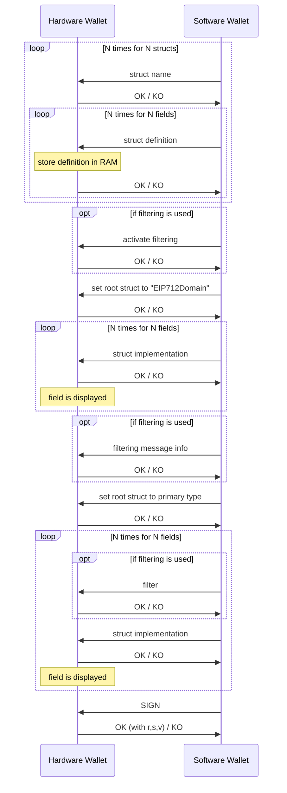

# EIP-712

## Specifications

[Reference](https://github.com/ethereum/EIPs/blob/master/EIPS/eip-712.md)

## Example message

```json
{
    "domain": {
        "chainId": 5,
        "name": "Ether Mail",
        "verifyingContract": "0xCcCCccccCCCCcCCCCCCcCcCccCcCCCcCcccccccC",
        "version": "1"
    },
    "message": {
        "contents": "Hello, Bob!",
        "from": {
            "name": "Cow",
            "wallets": [
                "0xCD2a3d9F938E13CD947Ec05AbC7FE734Df8DD826",
                "0xDeaDbeefdEAdbeefdEadbEEFdeadbeEFdEaDbeeF"
            ]
        },
        "to": {
            "name": "Bob",
            "wallets": [
                "0xbBbBBBBbbBBBbbbBbbBbbbbBBbBbbbbBbBbbBBbB",
                "0xB0BdaBea57B0BDABeA57b0bdABEA57b0BDabEa57",
                "0xB0B0b0b0b0b0B000000000000000000000000000"
            ]
        }
    },
    "primaryType": "Mail",
    "types": {
        "EIP712Domain": [
            { "name": "name", "type": "string" },
            { "name": "version", "type": "string" },
            { "name": "chainId", "type": "uint256" },
            { "name": "verifyingContract", "type": "address" }
        ],
        "Mail": [
            { "name": "from", "type": "Person" },
            { "name": "to", "type": "Person" },
            { "name": "contents", "type": "string" }
        ],
        "Person": [
            { "name": "name", "type": "string" },
            { "name": "wallets", "type": "address[]" }
        ]
    }
}
```

## Implementation



## Traversal

The traversal of the typed data with EIP-712 must follow the same order as the definition of the types. In the second
stage of the flow when receiving the implementation of the domain & message, there is no indication in
[the APDU](apdu.md#eip712-send-struct-implementation) of which field the data is for since the app has knowledge of
all the types it knows the exact order to follow so it keeps track of which field comes next and does its error-handling
accordingly.

## Filtering

Filtering is used for a better clear-signing experience with EIP-712.
It started as a simple way to define which fields to show (with the ability to give them an easier to understand name)
with all the other ones hidden to prevent the user from having too many unrelevant fields to review, and it has now
evolved into something more complex which can apply formatting to the filtered fields.

It has to be defined with the ERC-7730 format. Refer to [clear signing overview](https://developers.ledger.com/docs/clear-signing/overview).

It uses this optional APDU in the flow : [EIP712_FILTERING](apdu.md#eip712-filtering).

## Streaming

The data is streamed to the device, and as there is a lot to store in RAM : all the struct definitions throughout the
entire flow, it was decided to use streaming, so the device starts the message review before having received everything.

This is very efficient with RAM, but this also means the code is more complex to handle this, testing also is because
it makes the navigation difficult with Ragger, and the error-handling is happening as the user is already reviewing the
message which is far from ideal.

## V2

### Sending a message

EIP-712 V2 clear-signing structures. Delivered via the `EIP712 SEND STRUCT DEFINITION`,
`EIP712 SEND STRUCT IMPLEMENTATION` and `EIP712 SIGN` APDUs with `P2 = 0x02` (see
[apdu.md](apdu.md)), distinct from and never mixed with V1's incremental streaming protocol within
the same signing session: a V2 command is refused while a V1 session is in progress. Every payload
below uses the same chunked-TLV transport as `TRANSACTION_INFO`/`FIELD`: each payload is one TLV
blob, chunked uniformly regardless of payload type. The `VERSION` of every structure below is currently `0x01`; any other value is rejected.

Once `EIP712_SCHEMA` is received in full and parsed successfully, it is locked: any further
Schema APDU in the same session is rejected. Unlike V1, which uses a separate "activate"/lock
command, this needs none: one-shot delivery makes completion of the call itself the lock.

### Implementation limits

The structures below describe the wire format, which is deliberately more permissive than any
single device needs to be. An implementation may reject a well-formed payload that exceeds its
own capacity; the following limits apply to this application:

| Limit | Value | Applies to |
|-------|-------|------------|
| Array dimensions per field | 8 | `ARRAY_DIM` entries on one `EIP712_FIELD` |
| Value tree depth | 16 | combined struct nesting and array dimensions in `EIP712_VALUES` |
| Array dimension size | 255 | `ARRAY_DIM` payload value, though the wire type is `uint32` |
| Struct name length | 64 | `NAME` of an `EIP712_STRUCT`, `STRUCT_NAME` of an `EIP712_FIELD` and `PRIMARY_TYPE` |
| Derivation path length | 10 | `DERIVATION_PATH` entries |
| Payload size | available memory | each payload is fully buffered before parsing |

Nesting depth is shared between struct nesting and array dimensions, so a field declaring more
array dimensions than the remaining depth budget can never be populated with values.

### EIP712_MESSAGE_INFO

Merged into [TRANSACTION_INFO / EIP712_MESSAGE_INFO](tlv_structs.md#transaction_info--eip712_message_info)
above (`Context` column: `EIP-712 only`/`both`) rather than duplicated as a separate structure,
since almost every tag is identical between SignTx and EIP-712 — only the tags that identify
what is signed differ: `CHAIN_ID`, `CONTRACT_ADDR` and `SELECTOR` for SignTx, `DOMAIN_SEPARATOR` and
`PRIMARY_TYPE_HASH` for EIP-712.

It is delivered through `TRANSACTION INFO` with `P2 = 02` (see [apdu.md](apdu.md)), as one TLV
call, once `EIP712_VALUES` is complete and before the review starts, and at most once per message.
It is refused while a V1 session is in progress.

`VERSION`, `DOMAIN_SEPARATOR`, `PRIMARY_TYPE_HASH`, `FIELDS_HASH`, `OPERATION_TYPE` and `SIGNATURE`
are required, and `CHAIN_ID`, `CONTRACT_ADDR` and `SELECTOR` are refused. The creator, contract
name and deploy date tags are optional as in `TRANSACTION_INFO`. The signature is verified with the
same key usage as `TRANSACTION_INFO` (`CERTIFICATE_PUBLIC_KEY_USAGE_CALLDATA`).

The struct is then bound to the message it comes with, and refused (`SWO_INCORRECT_DATA`) if:

- `DOMAIN_SEPARATOR` is not `hashStruct(domain)` of the message's domain;
- `PRIMARY_TYPE_HASH` is not `keccak256(encodeType(primaryType))` of the message's type.

`PRIMARY_TYPE_HASH` does not cover `EIP712Domain`, which `DOMAIN_SEPARATOR`, `hashStruct(domain)`,
covers: every field of the domain, with its type, its `chainId` and `verifyingContract` included.
The message is on the chain of its domain, and is for its contract, when it has them.

`FIELDS_HASH` semantics for EIP-712: identical mechanism to SignTx — a running hash accumulated
over the **raw TLV bytes of each EIP712_FIELD descriptor as received** (order = transmission
order), checked once against the signed value. The commitment is at the descriptor-declaration
level (including any wildcard/slice), not at resolved-match level, so a descriptor whose path
matches zero elements at runtime (e.g. an empty array) is still correctly accounted for. This is
why EIP-712 V2 needs no equivalent to V1's per-filter "discarded path" signed marker: V1 signed
each filter individually and needed to separately prove non-existence; V2's single accumulated
hash over all descriptors' raw bytes sidesteps the problem structurally.

> [!NOTE]
> No command accepts `EIP712_FIELD_DESCRIPTOR` yet. A `FIELDS_HASH` other than the hash of no
> descriptors is accepted and kept, marked as announcing descriptors that are still to come, but
> nothing enforces it: the review is unchanged, a raw one behind the blind signing warning.

---

> [!WARNING]
> Everything below this point describes planned structures and open design questions. None of it
> is implemented by this application yet, unlike `EIP712_SCHEMA`, `EIP712_VALUES` and
> `EIP712_MESSAGE_INFO` above.
