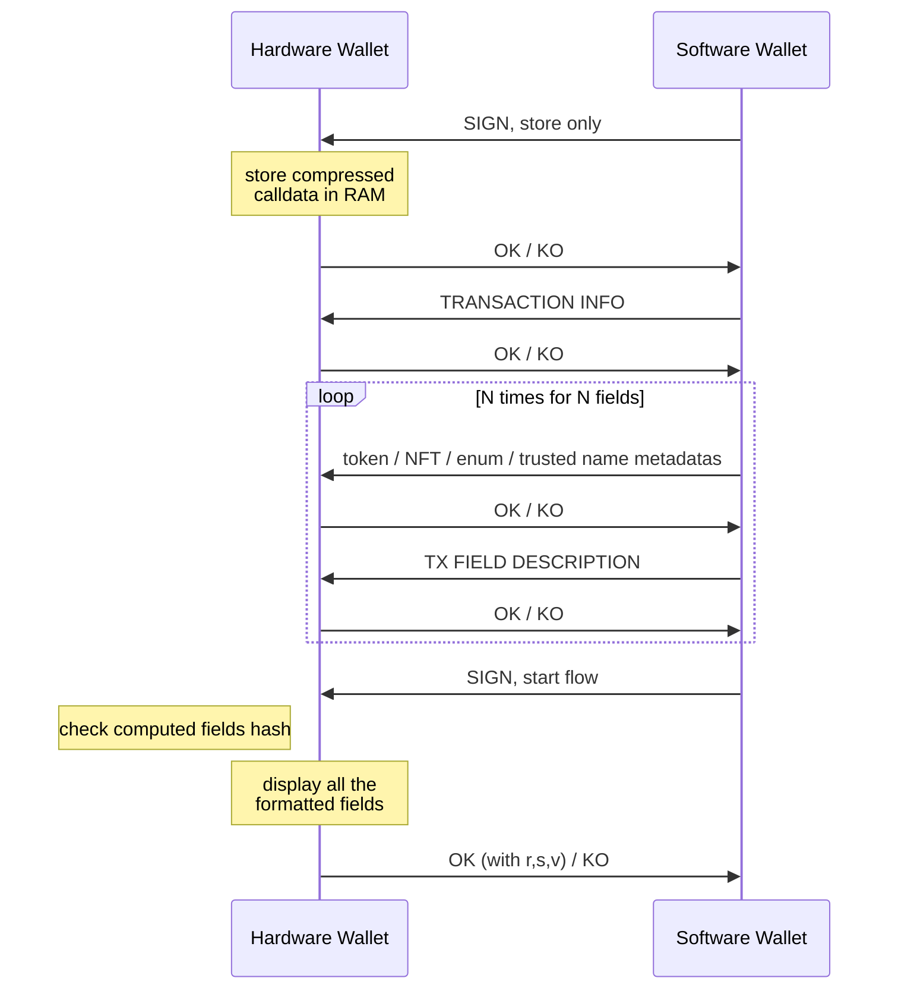
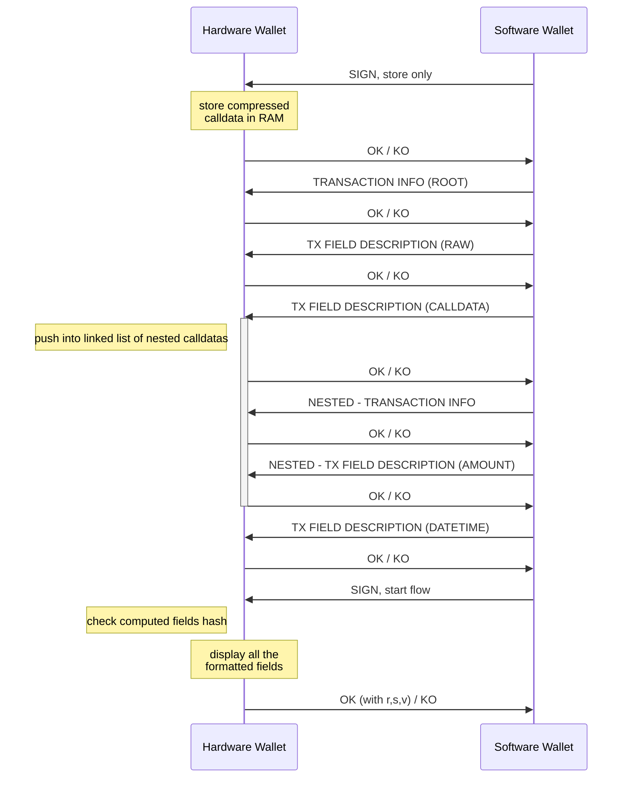
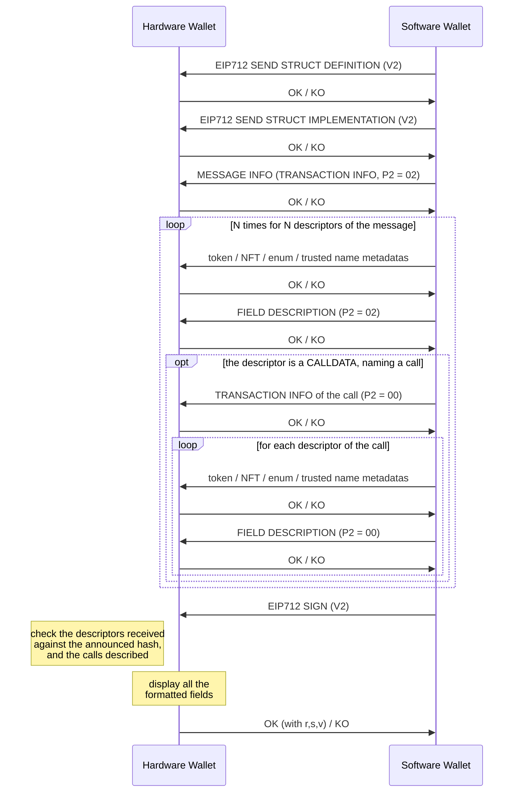

# Generic Clear-Signing

## Implementation

The metadata of a field (token, NFT, enum value, map entry, trusted name) is sent before the field
that uses it. An enum value or a map entry is for a function of a contract or for a primary type of
the domain of a typed message, which its tags tell: it can come before the TRANSACTION INFO of the
operation it is for.

## The case of nested calldatas

## The case of typed messages (EIP-712 V2)

An EIP-712 V2 message is described like a transaction, from the same
[ERC-7730](https://eips.ethereum.org/EIPS/eip-7730) description. Its `EIP712_MESSAGE_INFO` takes
the place of the `TRANSACTION_INFO`, and its descriptors (`P2 = 02`) read their values in the
message with an [EIP712_PATH](tlv_structs.md#eip712_path). The calls it makes are described as
transactions (`P2 = 00`), between its descriptors.

The metadata of a field is sent after the info of the operation the field belongs to, the message
info or the `TRANSACTION INFO` of a call, and before the descriptor that uses it.

The calls may also all be described after the last descriptor of the message, in the order they
were named. What is shown follows the order of reception.
