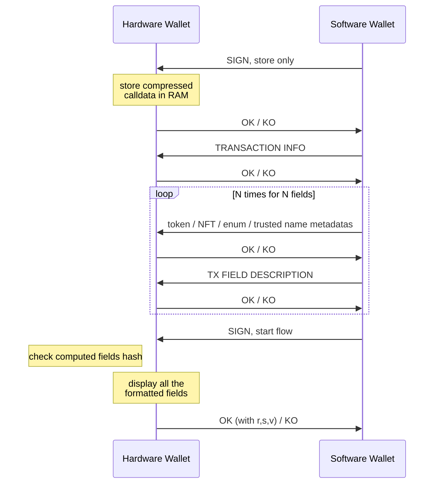
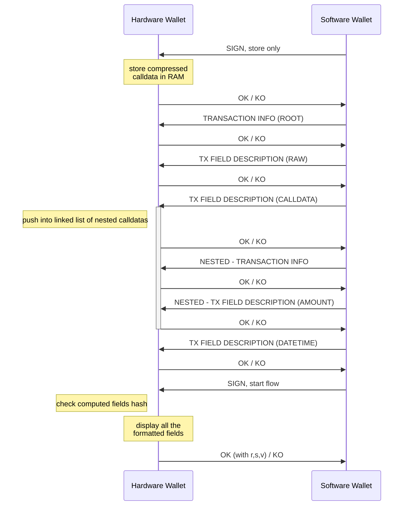

# Generic Clear-Signing

## Implementation

The metadata of a field (token, NFT, enum value, map entry, trusted name) is sent before the field
that uses it. An enum value or a map entry is for a function of a contract or for a primary type of
the domain of a typed message, which its tags tell: it can come before the TRANSACTION INFO of the
operation it is for.

## The case of nested calldatas

